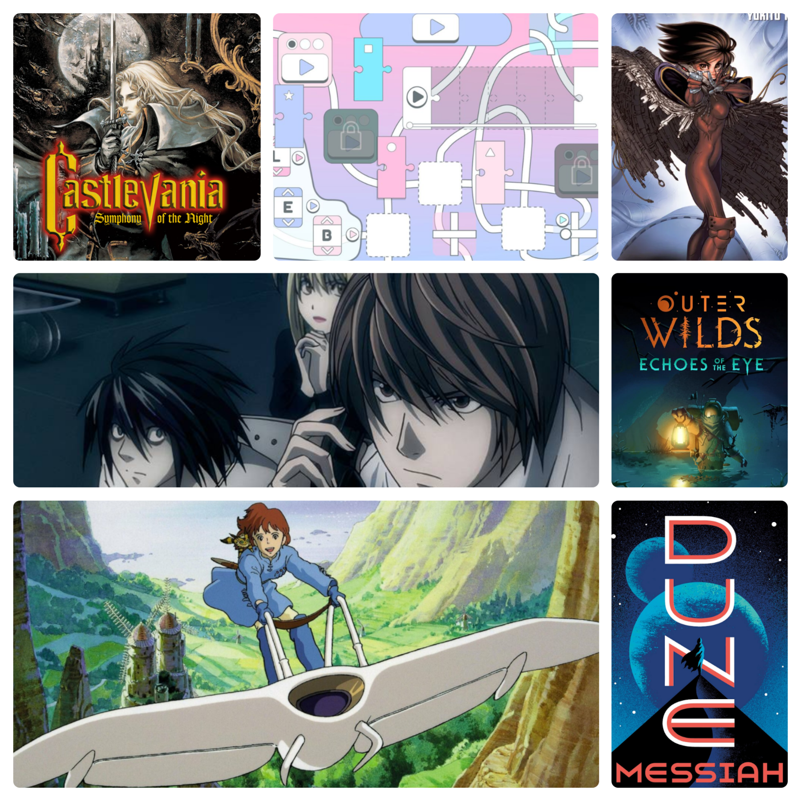

Another month goes by! For October I decided to mostly focus on a plan for my gaming and my reading! That's the reason I managed to get a lot of books done! I am quite happy with that progress, although I still have one week to finish all the games I planned. Still, this was all pretty cool!

<figure>

<figcaption>Some artwork of my favorite media that showed up during the month!</figcaption>
</figure>

## Podcasts

- **Into The Aether** - I listened to this the most, but not as much as usual because the last episode came out in October 31st and I didn't listen to it in time!
- **The Ten Minute Bible Hour** - A bunch of listened episodes this time around! Finally getting started on Matthew 17, and past the 400th episode!
- **Darknet Diaries** - I enjoyed a couple episodes this time: *Bayrob* and *Melody Fraud*. Although the casual chitchat on crypto annoys me sometimes.
- **Welcome to Night Vale** - I can't remember what I listened this time, I must have fell asleep quickly.

## Manga

- ✨ **Battle Angel Alita: Last Order** - Chapters 1-18. I started this one right after being done with the original run. Taking into account that a lot of the manga I read is in the hundreds of chapters, it's kinda funny how this became a new series instead of just continuing. I think there was a span of time between this continuation though so, I get it. I am really enjoying the continuation to Alita's story nonetheless. Perhaps the most confusing thing is the name changes though.

- ✅ **Battle Angel Alita** - Chapters 45-51. I started this manga ages ago, and to see it finally over was pretty cool! The finale, which felt a bit rushed originally, was replaced by *Last Order*, so I decided I'd give it a go too. I still really liked the finale of this run though, which goes for a more philosophical take on things and has some timeskips that worked well for me.

- **Blue Lock** - Chapters 360-364. Just the weekly chapters! It has been fun so far.

## Books

- ✅ **Dune Messiah** - This is the first physical book I've read in a while, and it was amazing from start to finish. I didn't expect to be so utterly hooked! Done with it in a week, reading it everyday during my trips to work. The plot is much more political and full of twists and difficult to understand dialogue, but I just couldn't stop myself. It felt ominous and grandiose and like something that I had to see through until the end. Good stuff.

- ✅ **The House on the Borderland** - A very interesting predecessor to what would eventually become space/existential horror and the like. This was a very interesting read, but with some dated elements in its writing. I have a feeling it won't impress you by itself without taking into account its context. It features a few different experiences from som old man living in this old house, and some are more interesting than others too. Overall pretty satisfied by it, since I haven't read anything like it.

- ✅ **The Left Hand of Darkness** - One of the more famous works of fiction, written by Ursula K. Le Guin. This was a very interesting story about some envoy tasked with establishing an alliance with a planet of androgynous people whose sex is only defined for a few days every month or so. And it's also a very cold planet. There is a bunch of interesting things going on because of this society's behaviour. But also political intrigue, survival, and understanding of each other.

- ✨ **Clarkesworld #212** - Only one of the short stories is done. I need to continue this one soon.

## Movies

- **Klaus** - Starting October with a chrismas film was not on my plans, but I am glad that it was this one nonetheless. I had a wonderful time watching this story. Beautiful animation, great characters, wonderful message. Just everything a christmas movie needs!

- **Bumblebee** - I have a feeling I watched this one at some point before, but not from start to finish, and not since I started to keep track of the movies I watch. In any case, Bumblebee is my favorite transformer and this origin story is quite a good coming-of-age story.

- **Nausicaä of the Valley of the Wind** - It has been ages since I had seen a Ghibli film. I had heard lots of things about this one. Seeing how it is considered as the "Dune of anime" and the like. This film is gorgeous. The animation, the story, the message, the world. It was mesmerizing to watch. I really really enjoyed everything about it, so much it's probably my favorite movie I've watched this year...

## Anime & TV Shows

- **Death Note** - Espisodes 7-8. I decided to return at last, and watched some more of this in the background. Since I read (and really enjoyed the Manga), revisiting this story has been quite nice. I am going for the Latin Spanish dub on this, which is quite good too.

- **Lanterns** - Episodes 4-5. For some reason I haven't watched more than a couple episodes. I should get going with this one some more, but well, I have put my focus elsewhere.

## Videogames

- ✅ **Final Fantasy IV** - The quintessential JRPG! Completed over a span of multiple years, I am glad that I gave it a go and managed to complete the whole thing and some extra dungeons!

- ✅ **Outer Wilds: Echoes of the Eye** - A paralogue to the story of the base game. Answering questions I didn't know I had, introducing new elements to the story, featuring new uses for tools that have always been available to me, and so much more. This was incredible, and the soundtrack was also pretty much perfect.

- ✅ **Strange Jigsaws** - This was an incredible puzzle game that really brings a lot of excellent ideas in a pretty tight package.

- ✨ **Castlevania: Symphony of the Night** - This is the second Castlevania I have played, and it has been a blast so far! I've played about 7 hours of it, the gameplay has been great, the artwork is insanely good for the PS1, and the score too! I enjoy it so far and I'm taking my time with it.

- ✨ **Meccha Chameleon** - This was a complete surprise! Everyone in my play group felt like giving it a go, so we started doing matches together and it became an instant favorite of ours. Hide and seek, brought to the next level!

- ✨ **Astral Ascent** - Only played this for like ten minutes so, yeah we'll see if I return to it.

- **Donkey Kong** - More pretty good platforming puzzles in the iceberg section of the game.
- **Kirby and the Forgotten Land** - Barely touched it this month. Focused on other games and books.
- **Ultimate Chicken Horse** - I even unlocked two new maps, there's not much left but this is still super fun.
- **Nintendo Switch Sports** - Still fun as ever! Golf and volleyball.
- **Guncho** - A great tactics roguelike I've mentioned before.

## Finishing thoughts

October is gone now. Even though I've managed to do a lot, completing three books and finishing some great games, it still feels like everything went by so fast. To be quite honest, I wrote most of this summary while watching more episodes of *Death Note*. Excuse the lack of detail or the quality of this summary overall.

This is day 61 of [#100DaysToOffload](https://100daystooffload.com)
