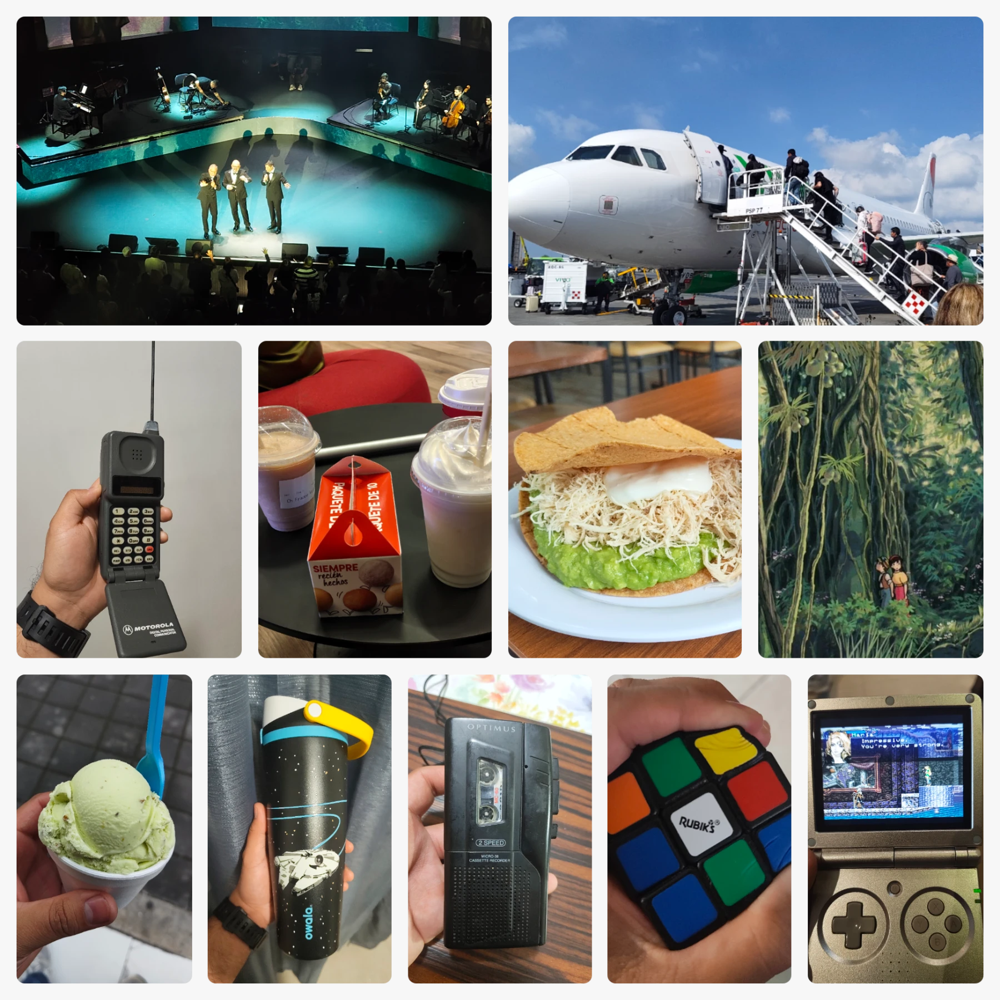

I basically took a whole week off, thus my weeknotes are late as well. I was behind on my Monthly Summary and this had to wait for a little longer. Nothing too bad though.

This week was jam-packed with stuff, lots of updates on things that happened, stuff I bought, places I went to, and food I ate, from October 27 to November 2, 2026!

- 🛬 [I flew on an airplane!](/blog/flight-log/) It was my first trip in about five (maybe eight) years, and well, even though the trip was only about an hour long, it was still a pretty cool experience to have after such a long time. It is also the first trip I took by myself, given previous trips were with family or friends.

- 🚘 My trip was to Monterrey! One of the biggest cities in Mexico with over five million people. I think the one thing I realized as an adult compared to my childhood there is the amount of time you spend just *stuck in traffic* in big cities. Taking like an hour just to go to some place nearby is kind of a pain. Thankfully it's not the only thing we did there.

- 🌮 Tried all sorts of food that's common there and that I had missed lately. One of my favorites is the *tostada siberiana*, as well as *gorditas*, *tacos de barbacoa*, *tortas* and *machaca con huevo*. I also tried a coffee shop called *Tim Horton* which seems to be more popular than Starbucks here, interesting stuff!---there's none where I live.

- 📚 There were a couple of book purchases this time around. On the digital realM---via Kobo store---I acquired the *Star Wars Trilogy* novelizations, *Recursion* by Blake Crouch, *The Great Divorce* by C.S. Lewis, and *Making it So* by Patrick Stewart. In the physical realm, I picked *The Three Body Problem* by Cixin Liu from my sibling, as well as acquiring *The Pilgrim's Progress* by John Bunyan and *The Screwtape Letters* by C.S. Lewis from a local library in Monterrey.

- 🎲 Also bought a cool Rubik's cube---if a little expensive---that is actually squishy! That's the only reason I got it. It actually turns! although it's an absolute pain to do so, just a nice trinket to have as a cubing enthusiast.

- 📻 The whole trip I stayed with family friends who I've known for decades (they are pretty much aunt and uncle to me). It was pretty cozy. My uncle showed me a whole collection of old coins from all over the country, all over the US, and all over the world. As well as some old tech gadgets and things around his home. I had seen a lot of this during my younger years, but I never really saw the appeal of it at the time. It was nice to find new appreciation for it all.

- 🎙️ One of the most interesting gadgets was a portable voice recorder, which used micro-cassettes and AA batteries! It still worked just fine and I managed to store my voice on it. My voice stored in physical format! Pretty cool stuff I have to say.

- 🎶 Went to my first concert! It was a live peformance of the album *Eterno* (Eternal), featuring Marco Barrientos, Marcos Witt and Marcos Vidal---three of the most influential singers of christian worship music in Spanish. It was all about the evolution of worship from old hymns, choruses, and contemporary songs. The music was amazing, hymns that are centuries old, songs that I've heard for decades, some I've never listened to before. All along classical instruments beautifully performed, and modern ones later too. It was a wonderful experience for me, I ran out of breath singing along!

- 👨‍✈️ On my flight back home, it looks like they had oversold tickets, and I was going to have to book another flight. I was already calling people to pick me up when support let me know that someone had canceled their seats, which means I was able to get back home as planned!

- 🛞 Some friends picked me up from the airport, and on our way back home one of the tires flattened. Unfortunately, the car jack also gave out and we had to wait for some help to come. Thankfully a taxi showed up which let us borrow their car jack and we managed to continue the ride without issue. Quite the way to get home!

<figure>

<figcaption>A collage of pretty much all I mentioned, the concert, the flight, an old Motorola phone, snacks, food, screen caps, and more!</figcaption>
</figure>

## Watching

🐛🛩️ **Nausicaa of the Valley of the Wind** - WOW WOW WOW. I watched this film on a whim, after hearing so much about it. All I knew is that it was often compared to *Dune* and NOTHING MORE. I am extremely happy that I went fully blind and ready to be amazed for this one because AMAZE ME IT DID. This movie has it all. Some extremely awesome sci-fi concepts, some fantastic artwork, an incredible soundtrack, a really captivating story, and a beautiful message as well. Give it a go please.

☁️🏰 **Castle in the Sky** - WOW WOW WOW. I had to keep going on my Ghibli journey and decided to check this. The only thing I knew about it was the name of the floating city is "Laputa", which is a pretty bad word in Spanish. Other than that I was AMAZED BY THE WHOLE THING AGAIN. I was NOT expecting the direction this wonderful thing took. It really reminded me of *Breath of The Wild* (and definitely *Tears of the Kingdom* although I haven't played it myself yet) and it was so wonderful. Watch Ghibli movies.

💀📓 **Death Note** - Episodes 7-31. I continued my journey through anime-land by returning and binge-watching some more *Death Note*. I got through pretty much the whole thing now. Only the last few chapters remain. I definitely feel how the later episodes got a little convoluted and messy compared to the first 25 or so. Nonetheless, I am here for the ride wherever it leads (I already know the manga but I still enjoy the drama that the voice acting and the soundtrack brings).

## Reading
 
🌌🪱 **Dune Messiah** - Well this book was pretty much already complete last week, I simply went through the last few chapters in half an hour or so, and yeah, that was some crazy stuff that unfolded all of a sudden, ending in the only way it could end. I really enjoyed the build-up and the writing and dialogue, as weird and challenging as it was, it kind of just felt right, I don't know, but good book!

## Gaming
 
🏰🦇 **Castlevania: Symphony of the Night** - I gave this a pretty good run while waiting at the airport and played it on and off during my vacation. This game is fantastic so far! Although it definitely has some aspects that you simply have to accept as what they are for the time. I have gotten plenty of unlockables and power-ups and discovered plenty of cool places. I've met some interesting characters with kinda whacky dialogue (and voice acting) and managed to get the Bat power-up at last. There are many secrets in this castle!

🗡🎲️ **Slice & Dice** - There was this very unexpected and huge update to this game that added HUNDREDS of new characters, power-ups, enemies and mechanics. Basically mods made by the community that were added to the base game by the developer. This has been absolutely incredible to see and it makes an already huge roguelike even more chaotic and fun. I am looking forward to doing some more runs of this gem.

## Around the Web

I pretty much went offline on my blog reading during all of the week. I could be looking for something to share today but I'd rather not pretend like I read any blogposts. I did watch some YouTube videos though so you can check these:

- [Gunnm - Battle Angel Alita - Motorball CGI 3D VFX Short 銃夢](https://youtu.be/YQDdj01QPi4) - A CGI short film from the year 2000 featuring Alita doing some sick moves. Only three minutes of PS1-style FMV graphics!

- [Running Minecraft Until It Beats Itself](https://youtu.be/9t2fV52jMA8) - This was a wild video to watch and I really had fun seeing how everything happened on it. Billions of years of simulation, this is what the internet is all about!

- [They sold us a lie (and it’s still working)](https://youtu.be/XrZ4Vozni3o) - Putting the blame on climate change on the people rather than corporations and lack of policies, evil stuff!

- [How are people reading so many books?](https://youtu.be/YwmJTP5X1c0) - I was feeling self-conscious about how I feel happy to have read three books in a month when some people seem to read dozens, but I feel ok now.

This is day 62 of [#100DaysToOffload](https://100daystooffload.com)

