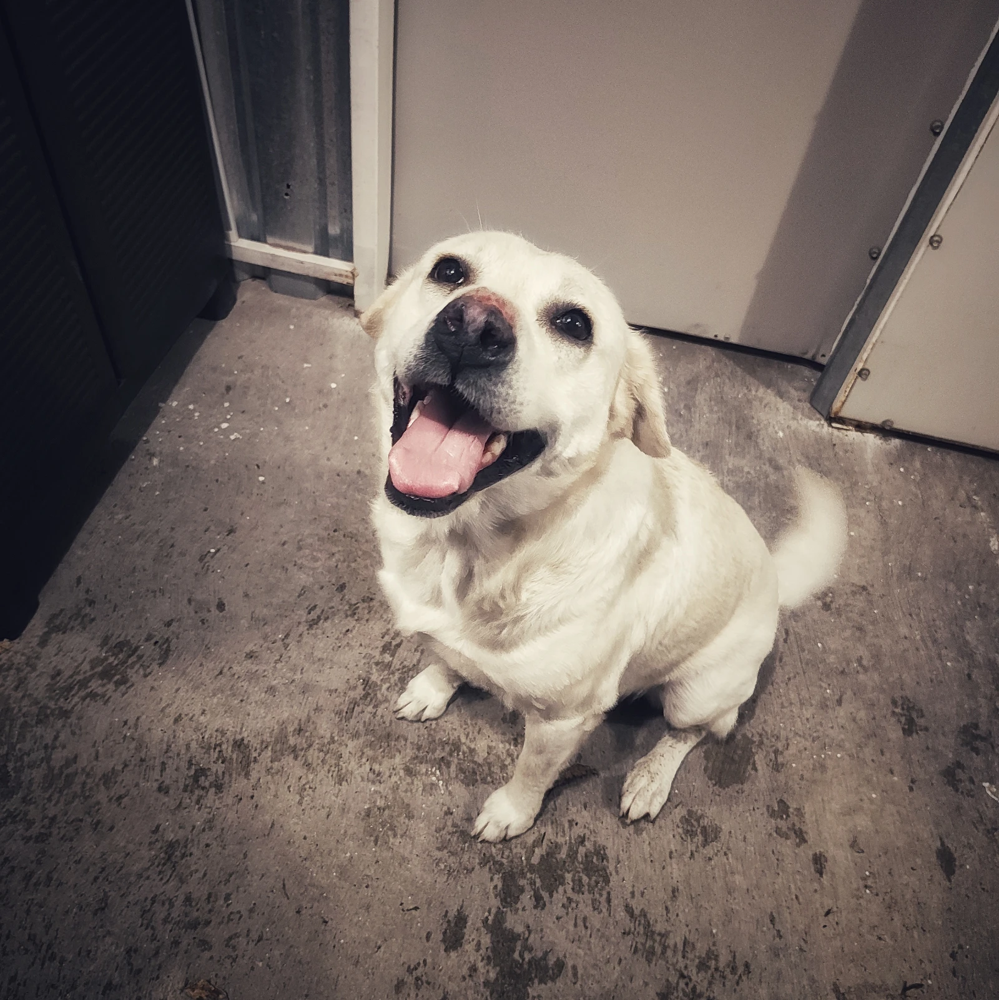

I saw some bloggers and friends participating on this prompt/challege, which---of course---originates from [Robert Birming's](https://robertbirming.com/knowember/) mind. Even though I'm one of the ones who feels like the about page I have covers pretty much everything, I decided to contribute with my own entry anyway.

## A photo

You can find two pretty faithful pixel art recreations of me on both my [home page](/) and my [about page](/about/). These will do for most situations. Here I decided to share a picture of one of my dogs, her name is Lana and she's a very good girl!

<figure>

<figcaption>She can't help but wag her tail all the time</figcaption>
</figure>

## Name or nickname

As some of you know, my name is Joel, and `joelchrono` is my username in most places. I have told this story many times, an older username I had was hard to pronounce in English on Twitch streams, and I went for "Chrono" from Chrono Trigger and appended it to my regular name, not much else to say at this point! Best videogame of all time, not the best username for sure.

Part of me wishes I had gone for a nickname that doesn't use my real name in any way, but it's kinda late for that at this point, I don't mind it much.

## Where in the world I blog from

I blog from México! I live in the state of Jalisco and that's where I post from most of the time, usually via my laptop or my phone.

All I do is upload markdown files to my repo and go from there. I have a whole set-up for this on my laptop, but on my phone I just upload files to GitHub's website directly. This has made my commit history a little bit ugly, I must admit.

I definitely prefer when I get to sit on my desk at home and write away, but the time for that has lessened since I started to work! Definitely try to do that during weekends though, if I don't get hooked by some videogame.

## What my blog is mostly about

My website is about pretty much everything that lives inside of my head at any given time. I talk about many things. The videogames I play, the books I read, my personal thoughts here and there, regarding whatever situations in my life I'm going through. Every once in a while I mention the state of technology, or what's on my phone or talk about childhood memories. Maybe I'll mention a pet of mine, or how my website works, or my thoughts after binge-watching a whole movie franchise.

Do not stick with me if you want me to have serious topics or essays on whatever is trending, although I may dwell on those things from time to time. I do enjoy to know I am being read, and sometimes that affects what I write, but I try to remind myself that most of what I share is because I want to talk about more people about it, so I'm always happy to get comments from people who share my interests and such.

Basically, it's just me and my hobbies and random thoughts, and if you are lucky, some useful tutorial about some niche thing like FreshRSS.

This is day 66 of [#100DaysToOffload](https://100DaysToOffload.com)

