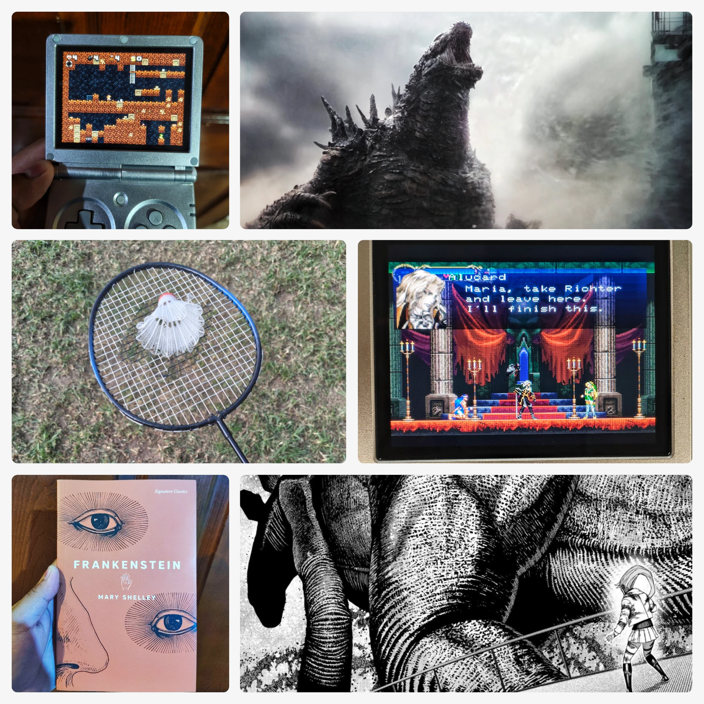

This week was full of interesting stuff, a first-time experience and a very cozy weather. I'm still sleeping with a fan on (even if it's cold) and I need to cancel my gym subscription, I don't think it's working out and I could save the money...

Anyway, here are some things of note this week, from November 3 to 9, 2026!

✍️ I am slowly catching up on my reviews. I posted the ones for all the books I read during October, but I'm still behind on my reviews for *Echoes of the Eye* and for *Strange Jigsaws*, both of those games were absolutely marvelous, I definitely want to cover them soon.

🎮 With the remake of *Ocarina of Time* finally released, the urge for a Nintendo Switch 2 is higher than ever. I even purchased the *Final Fantasy VII* remakes for it since they were on a HUGE sale on the eShop. Building up a library for a console I don't even own yet... look how far I've fallen.

🕹️ I have been fiddling around with [Retroshelf](https://retroshelf.org), a game tracking website that offers integration with handhelds like my Anbernic RG35XX SP, using plugins that automatically track my play sessions! It imported all of my statistics and it even connects to my RetroAchievements account, super cool stuff! If you have a handhelds from Miyoo, TrimUI or even a Steam Deck, you can give it a go if you want something less manual than [Backloggd](https://backloggd.com).

📽️ My parents were busy on the weekend and I decided to go to the movies all by myself! I saw *Godzilla Minus Zero*. I was the only person in the whole row, I ordered a bunch of popcorn and soda and a hot dog, and I had the time of my life. Okay it wasn't actually that different from going with my parents, but it was fun to get there and do all that by myself.

🃏 I've been studying up a little bit more card magic, presentation and techniques. It's been fun to keep diving into this hobby and art! My playing cards have gotten quite a bit of use lately, it may be time to open up a new deck (I actually have like three unused ones waiting for their turn). I kind of want to challenge myself to perform magic to strangers daily.

🏖️ On Sunday my church went to a Palapa (with a pool!) and we had our worship service there. Some people got baptized and we all had lunch together and did plenty of tabletop gaming, chatter. celebrating and the like.

🏸 Of course, I also brought the Badminton net and rackets and we played quite a bit, I even managed to get a pretty decent rally recorded on video (which I won't share here because privacy and also it's really not that big a deal).

<figure>

<figcaption>A collage of pretty much all I mentioned, Godzilla, Spelunky, Badminton, Castlevania, Frankenstein and DanDaDan</figcaption>
</figure>

## Reading

An absolute classic, the return of a favourite and the new one proving itself.

🧪🧟‍♂️ **Frankenstein** - Progress: 42% (There's no standard chapter count). That's right folks, since two of the three novels I picked for October weren't really that spookey, I decided to go with an absolute classic this time, and what a better choice than Mary Shelley's *The Modern Prometheus*. I knew of Frankenstein because popular culture, but I had never checked out the source. This novel is completely different from what I expected and it holds up extremely well. It is a trainwreck of emotions and very interesting characters so far. I have a feeling I could finish the rest of this in a single day, in fact, I may. It's just so good!

🦖👺 **DanDaDan** - Chapters 230-251. Decided to return to this at last, after quite a few chapters built up. It looks like people were hating on the progression because the author decided to use an annoying ammnesia plot, but reading through a chunk of it in a single sitting and having the latest chapter set some epic stakes that will clearly fix some things up was cool. Will wait another while before returning though.

🛰️🤖 **Blame!** - Chapters 13-17. I gave a go to a few more chapters of this series and some very interesting revelations were made here. The longer format continues to make me feel like I'm going very slow, but it's okay, I am letting the implications of this story simmer a bit more, I like to think.

## Gaming

More Castlevania? More fun, and some spelunking on the side.

🏰🦇 **Castlevania: Symphony of the Night** - I continued to play this for many more hours, and have pretty much completed two of its endings. Because of this I have unlocked a crazy post-game which you should be familiar with if you've played it before. I continued to explore the and fight many enemies that are much more dangerous. There have been some great boss fights as well, and even though I feel more powerful than ever, the challenge has definitely increased. It's good stuff!

💎⛏️ **Spelunky Classic HD** - After I saw my friend Bojidar [completing this](https://bojidar-bg.dev/blog/weeknotes-1344/), I decided to revisit it on my handheld too. I'm playing the PortMaster version. It plays great and I've managed to get to the second "biome" already! A very simple premise that is full of challenges and discoveries to make. Definitely looking forward to actually getting good at it. Maybe in less than 500 attempts...

## Watching

The big lizard has returned triumphant, time travelling goes wrong, and the new world of Kira comes to an end.

🦎🐉 **Godzilla Minus Zero** - I went to the movies by myself to watch this film. *Minus One* is among my favorite all-time movies, and this one was an incredible continuation with a lot of ambitious. King Gidorah was an absolute menace and every minute of Kaiju action was terrifying and heavently. Apparently Godzilla only shows up for six minutes, but I was absolutely on the edge of my seat the whole time. My jaw was genuinely, physically dropped, in complete awe of what was going on the whole time. This is an experience you MUST have on the cinemas, I BEG YOU---just be ready to protect your eardrums. Definitely rewatching with parents soon.

🕛📅 **Back To The Future 2** - My dad put this on the TV and I thought I'd stick around to watch it, it's a classic for a reason. I had a lot of fun seeing it after quite a while. I actually didn't remember how all the movies kind of happen in a matter of a couple days, so that was kind of fun to see.

💀📓 **Death Note** - Episodes 31-37. Completed Death Note once more, the second part of this anime definitely felt more rushed at the end, with many things that weren't really developed as well as the first 25 episodes. In any case, I still enjoyed the build-up and the stakes of this one. It's popular for a reason, after all! I'll stick with the manga as a preference though.

## Around the Web

- [Caroline isn’t real - An adventure in ai-induced psychosis](https://dandelion-utilitarian.com/2026/11/01/caroline-isnt-real-an-adventure.html) - This was a bit of a horror story, I'm glad they got out of this soon enough.

- [Be like me. Don't be like me.](https://schafe-sind-bessere-rasenmaeher.de/mindfulness/be-like-me-dont-be-like-me/) - Robert's adventures on parenthood never fail to be rather thought-provoking.

- [Boss Battles](https://gabz.blog/posts/boss-battles) - Gabz has been dealing with some pretty tough bosses lately and I can relate as well.

- [On being an inconvenience](https://tracydurnell.com/2026/11/01/on-being-an-inconvenience/) - It is always okay to ask for help!

- [On Receiving Letters](https://brainbaking.com/post/2026/11/on-receiving-letters/) - Look at all those awesome envelope designs... I need...

This has been day 67 of [#100DaysToOffload](https://100DaysToOffload.com)
 
