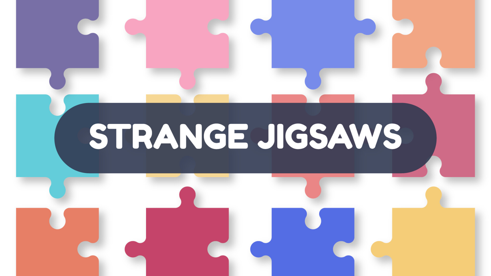

Strange Jigsaws is a puzzle game that brings quite a lot of mind-bending mechanics to the table. A lot of the puzzles are the type that requires you to really think outside the box, subverting the way you may expect a solution to go in the most amusing of ways.

Even though a lot of the puzzles toy around with the typical of rotating and assembling shapes, there are plenty of environments wich recontextualize this classic idea, both in the design and on its visuals. I played this game in a single day, and it was quite the trip!

<figure>

<figcaption>Artwork of the game</figcaption>
</figure>

The game is one of those that you can really only go through once, each puzzle has a single hand-crafted solution, so, like Outer Wilds there really isn't a lot I can say that won't ruin or giveaway hints that may hinder your experience with the game.

In any case, the structure of the puzzles is quite interesting too. There are multiple puzzles that you can solve and make progress through at once, with plenty of different mechanics that are used panning through multiple screens, UI elements and even the pause menu.

While there are plenty of puzzles to do at once, there are also locked puzzles where you have to solve some other puzzles to access them. Making level progression itself another matter to solve.

Think of this game like a giant escape room or multi-dimensional puzzle box where you will have to use nothing but your mouse (and sometimes some extra keys) to find your way out.

I loved the presentation of this game, featuring multiple art styles, funny references and a charm like no other. It's pretty much a love letter to puzzle design.

That isn't to say that there aren't some parts that are kinda confusing in annoying ways. I think however that you just gotta stick with it and keep trying to look at every possible angle before giving up.

In any case, there's a [hints page](https://www.flebpuzzles.com/sj_hints/) you can check if you are truly lost. I have to admit I used it a couple times myself.

Another thing of note is that this game was made using the Godot Engine, which I quite like!

The game is honestly pretty cheap and definitely worth it if you are looking for something you can realistically beat in a single afternoon. It took me about 4 hours---because I'm kind of bad at puzzles I guess---but you can definitely do it in less than three if you focus! It's available on [Steam](https://store.steampowered.com/app/2702170/Strange_Jigsaws/) if you want to check it out.

It has been a while since I've done short reviews like this one, but I've guess I have played way too many games that have a lot of moving parts. Even though there are a bunch of those here, with its amazing moments and eurekas to get from this one, it's definitely better to just go blind at it and enjoy it as unspoiled as possible.

This is day 70 of [#100DaysToOffload](https://100daystooffload.com)
