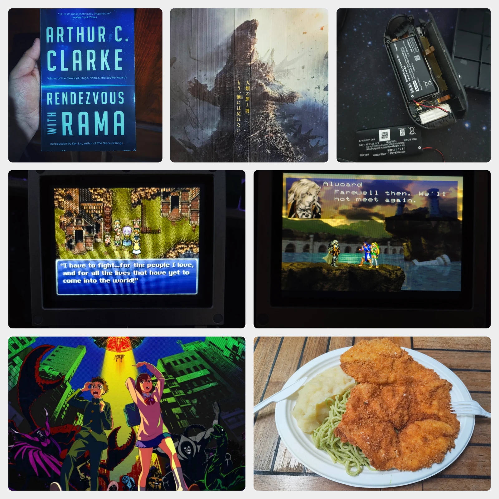

Late weeknotes this time around. I had vacation on Monday 16 due to Mexican Revolution Day---which is actually on the 20th but whatever. It was also *El Buen Fin*---the equivalent of Black Friday in Mexico---so
I hope you understand why I didn't have the time to finish writing these.

Anyway, let's backtrack through some events that happened between November 10 and 16 of 2026.

- 🎮 Got a visit from an old friend that showed up at my house! We played some *Super Mario 3D World* and we had a nice chat about life and such. He also watched *Godzilla Minus Zero* and loved it so of course we had a good time.

- 💉 I think the biggest thing that happened last week was that I got my shots for flu and covid. This was funny because the nurses came to the office and were stationed right in front of my desk (it's an open office space). They were in my peripheral vision and even though I admit I don't like getting vaccinated, I caved to the pressure of seeing them in front of me. Plus it was the right thing to do.

- 🤒 This didn't work out very well, at night I got a bit of a fever, headache and back pain, such is life sometimes. I showed up to work anyway but ended up asking for to leave early. My boss was cool with it!

- 💻 The next day I decided to just do home office, and things were chill. That night was still uncomfortable but I got much better in the morning, I guess I could have gone to my workplace but it was awesome to pretty much get a long weekend combined with Monday.

- 📕 I had a very scary moment with my Kobo where it refused to connect via USB to my Laptop. Both times the USBMS session got interrupted, and the LED light would start blinking. I feared some corruption may have ruined the SD card, but it turned out alright. I finally figured out how to get Calibre wireless transfers to KOReader due to this though, so... win?

- 📖 My Bible reading has been going great, I'm catching up with my original plan. I'm almost done with Proverbs, I flew through both of Samuel's books and going through Chronicles and Kings.

- 🔋 Performed a battery replacement on a spare Nintendo Switch joycon. I actually did an oopsie by removing the old battery, and then---in a display of absolute genius---installing the old battery again,
assembling it all together and not realizing until I had already put the screws and all in place. Second try was alright.

<figure>

<figcaption>Collage of the week! book, movie poster, joycon, screencaps, anime and some food.</figcaption>
</figure>

## Watching

- **Godzilla Minus Zero** - Yep, I watched it again. This time with my parents! It was as epic as the first time and my parents really had a good time too.

- **DanDaDan Season 1** - Episodes 1-3. I felt like watching some more anime before the year ends and why not start with the adaptation of one of my favorite manga? The first episode is probably the most weird, with lots of uncomfortable scenes, but I know the writing goes on a better direction in the future.

## Gaming

- ✅ **Castlevania: Symphony of the Night** - I have finally completed one of the quintessential entries in the Metroidvania genre! I continued to explore the Inverted Castle and uncovered a lot of its secrets and bosses, making my way to the very core to face against Dracula himself. This was an epic journey, so much so I faced the last boss twice to get both endings available depending on map completion. It was super fun! Review coming up at some point.

- ✨ **Resident Evil 3** - This is the last game I had planned for October. Even though I'm past the due date, I decided to check this out anyway. I only played it for like twenty minutes, but I'm enjoying so far, the new ammo system looks interesting...

- **Super Mario 3D World** - So a friend mid-week and we decided to play some Switch and I realized I only had the last Bowser level left and we beat the game in that one sitting! I'm still playing it in multiplayer with other friends to get all the stamps, stars and gold flags!

- **Final Fantasy VI** - I ended up venturing into this journey for a bit, and managed to get Terra to join me again. That was a very stressing boss fight! I actually hadn't done a proper save before going into it and almost lost, but managed to hold on until the end.

- **Spelunky** - Alongside the classic entry I started last week, my friends felt up for a couple of rounds of the Switch version. This was very fun and we actually locked in for a little while there, though we died eventually to some silly chain of events.

- **Nintendo Switch Sports** - I played some volleyball for a bit, but not much else.

## Reading

- ✅ **Frankenstein** by Mary Shelley. I completed this book pretty much the very same day I published my previous weeknotes. I couldn't stop reading throug it. The novel is an amazing piece of work, which definitely defined a genre. I have already posted [my review](/blog/frankenstein/) for it, so check it out!

- ✅ **The Star** by H.G. Wells - This short story about a star that approaches the Earth and causes cataclysm was mentioned in another book I started reading---see below. I gave it a go and I couldn't stop until it was over. I went through it twice, the second was via an [audiobook version](https://youtu.be/63rPR2nh9f0), with a superb voice performance and sound effects (and no AI!). It was so good!

- ✅ **Frankenstein** by Junji Ito. This manga adaptation does some interesting changes to the original story. It's not split into chapters or anything, just 170+ pages of awesome artwork and pretty creepy stuff.

- ✨ **Redezvous with Rama** by Arthur C. Clarke. After finishing a classic, I decided to go with another, more modern classic! A strange object approaches Earth, this time, it's a weird cilinder structure that is clearly alien in nature. So far so good, but I haven't read enough of it to judge more. I enjoy the chapters being only 5 or so pages long though, I feel like I'll fly through it!

- **My Wife is from a Thousand Years Ago** - Chapters 289-300. It has been fun to read through the shenanigans of this couple once more!

- **Blame!** - Chapter 18. I did so many things between reading this chapter and now I kinda forgot what happened.

## Around the Web

### Blog posts

- [Creating Your Own Gaming Backlog Yields Behavioural Insights](https://brainbaking.com/post/2026/11/creating-your-own-gaming-backlog-yields-behavioural-insights/) - Wouter has realized that he has three years worth of playtime on his library, so he'll stop buying games during all of 2027. Wild stuff!

- [A return and a redesign](https://rachsmith.com/return-and-redesign) - Rach Smith is back to blogging, and that's awesome!

- [How I read your blogs](https://thamara.co.uk/notebook/2026/11/how-i-read-your-blogs/) - Such a neat post about RSS and such. Thanks for the shoutout!

- [My Excuses for a Long Reading List](https://marisabel.nl/public/blog/My_Excuses_for_a_Long_Reading_List) - Just more books listed to add to my own list, perhaps.

### YouTube

- [The World Design of Castlevania: Symphony of the Night](https://youtu.be/a1hHOVIkrcc) - Game Maker's Toolkit epic series on game design and such. I got to appreciate a lot of the details of the game here, and yeah, it's good stuff!

- [How to send ebooks wirelessly to your e-Reader using KOReader & Calibre](https://youtu.be/AQHbOTEJAak) - This was pretty useful information that I was unaware of for way too long despite using KOREader for a couple years at this point.

- [Beating Castlevania SotN EXACTLY As Konami Intended](https://youtu.be/8uJz7cz_YwU) - I didn't even know there were guides inside the game itself to beat every boss, that was an interesting surprise!

- [The Switch 2 Jailbreak is Here.](https://youtu.be/wtp3OolekmA) - I haven't purchased a Nintendo Switch 2 yet, and perhaps I'm too late now for this anyway.

- [My Girlfriend asked me why Symphony of the Night is so perfect](https://youtu.be/KQdd8QrTyEY) - I watched a couple of playthroughs of this game but I just loved this one! She ended up better equipped than me too, lol.

This is day 71 of [#100DaysToOffload](https://100daystooffload.com)
