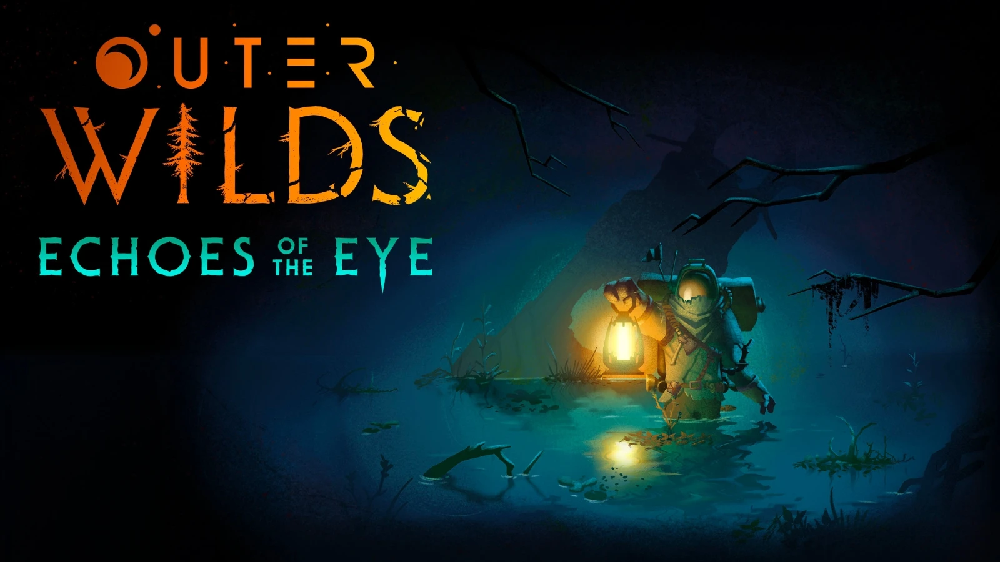

You have no idea how incredibly happy I am that I finally get to write about the world of *Outer Wilds* again! I feel a little bad about the shortness of my post on [Strange Jigsaws](/blog/strange-jigsaws/) because that game is wonderful too, but there's no way to put. The *Echoes of the Eye* expansion reached for me, I have stumbled upon its signal, and I had to follow its call.

**First off. It is extremely important that you play the [original game](/blog/outer-wilds/) and this expansion completely---absolutely---blind. As blind as possible.**

My original review is spoiler-free---and this one will be too---but please, do yourself a favor and experience that game with your own eyes. I beg of you.

<figure>

<figcaption>Artwork of the game</figcaption>
</figure>

I let the original game simmer for quite a while inside my head, watching multiple playthroughs trying to reexperience it all over again and again through other people's eyes. Every single experience is completely different for everyone who plays this. On the side, I completed some great books, finished some other awesome videogames, and got back into the rythm of my new life after playing Outer Wilds.

I got to enjoy the ending of base game by doing this, and I'm glad I didn't jump right to the expansion. I believe this was the right move, as more than a regular DLC, this is pretty much a paralogue story that will take about 10+ hours to complete.

What you ought to do then is pretty easy: Enjoy the original game, think about it, reflect on how it made you feel, consider that there's pretty much nothing like it. Watch more playthroughs, try to enjoy life knowing this was it. It is done.

Only then, when you are content and grateful with what you have, and you are almost okay with the fact that *there's more to explore here*. That's where you let that itch build up again. The itch for more mysteries to solve, an adventure that only *Outer Wilds* can provide, only then shall you return and embark on this journey---one last time.

---

The expansion for *Outer Wilds* came out in 2021, a few years after the original game. Think how it must have felt like an eternity for those who first played this back in the day. Imagine the emotions, all of a sudden rushing back through you. Your strength to keep going in life is renewed thanks to such an announcement! 

Thankfully, since I have the *Archeologist Edition* for Nintendo Switch in physical format, all I had left to do was play! Thank goodness.

*Echoes of the Eye* is perfectly integrated to the original game's solar system and the ongoing narrative. The way it manages to do that? I'm not going to say. All you need to do is check one of the first areas in the game, the museum, which has some new exhibitions once the expansion is installed. It shows some pictures that will guide you to the place where this new quest begins.

That's right, getting to the expansion is a puzzle in and on itself, and I don't really want to spoil anything about it!

What you need to know is that this is smaller in scope and will unfold in a single location. This place will hide some of the most mind-bending secrets in the solar system. New revelations that will be completely different from anything you've seen before, and even challenge some of your preconceptions and things you took for granted.

Questions you didn't even know you had will be answered, perspectives that you would have never come up with will be shown. Trust the process, things will eventually make sense again.

Given how everything will take place in a smaller location, unrelated to the rest of the solar system. The puzzle design of this expansion is much more focused, and it's less likely for you to veer into multiple different paths as well. Basically, it's more linear, there are only so many ways for you to get lost, which is both good and bad!

Good, because you could will find yourself in a constant flow of ideas, discovering thread after thread that will surely lead you to solve the main puzzle of this game with all your previous experience. Bad, because unlike the base game, where you can do a whole change of pace and look for unrelated clues and secrets, losing yourself in the vastness of space, here you will have to figure it out.

Basically, the expansion is a tiny version of the base game, much more concise and compressed. I am honestly impressed by the fact they managed to squeeze so much out of what seems, at first glance, to be so little, but they manage to do it, and it simply works.

There is, however, one thing this game will do that you may not expect: It can be scary. You may not believe it at first because everything looks awesome and beautiful and inviting, but you will see how it'll go. The game includes a "Reduce Frights" option, which I decided to turn on.

Of course, there is more to it than just that. This is Outer Wilds we are talking about.

The music is top notch once again. The whole soundtrack by Andrew Prahlow is just as wonderful as the one for the base game. In fact, I very much think that the sound design of the expansion is superior to the base game. It conveys information and emotion beautifully. In fact, the audio experience is essential to fully grasp the significance of this new location. There is no need to fight though. I am grateful that I can listen to both soundtracks. Truly wonderful stuff.

I feel like I've said too much already, perhaps you don't get it yet, but trust me, just like with the first game, you will. There is a way to get around everything you'll face here. I know you'll love it if you completed the base game. Face your fears, and get to it!

This is day 72 of [#100DaysToOffload](https://100daystooffload.com)
