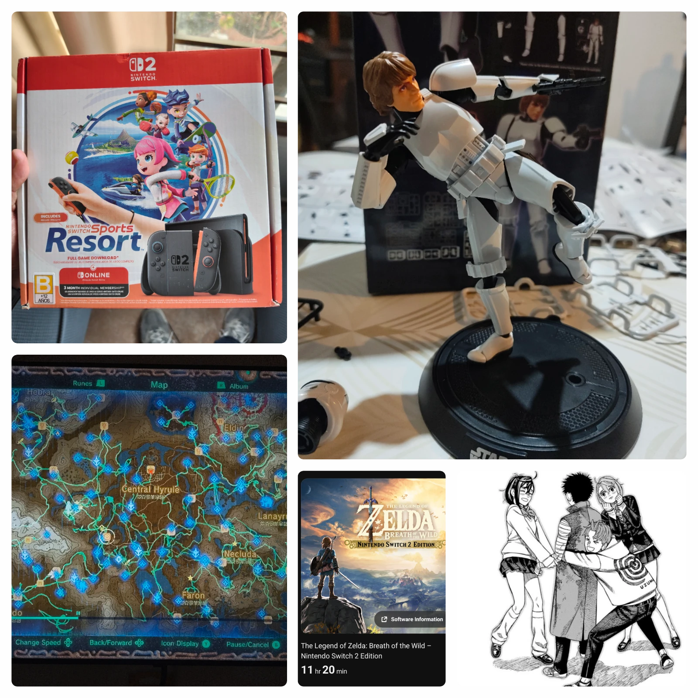

Behold, everything that happened between November 17 to 23, 2026. Okay maybe not everything but plenty of stuff I did, I guess!

- 🧱 I've been interested on Gunpla and model kits that you assemble yourself for a while. I found a brand called *Blokees* that seemed reputable but cheap, and decided to buy a model of Luke Skywalker disguised as a storm trooper. It was a nice couple hours (a little less maybe) to assemble, and the final result is very cool and can be set in pretty much any position!

- 🎸 I've had a guitar for a few years that needed some real maintenance and repairs. I finally got that sorted out with a professional and I have to say, the result absolutely amazed me. It feels better than brand new, all the strings are so much easier to press and it sounds glorious. I didn't expect it to change so much but yeah, worth every cent.

- 🏠 Once again, I'm home alone, and that means I got some free time for gaming on the living room! But I also had to cook for myself and keep the house clean and such. It's been nice to chill at my own pace to be honest.

- 🏃 I actually made a deal with my parents to lower my weight by the time they came back, so I've done some excercising! Bicycle stuff, calisthenics, and all that. Taking care of my diet as well, with a few exceptions but nothing major. I don't think a lot will change in a week but it's okay.

- 🎮 I also purchased a Nintendo Switch 2 and a whole lotta things have happened with it. The transfer from my Switch 1 was pretty painless and I was able to experience some old and new games on it, which I'll mention later on these notes. I got a screen protector and an ergonomic grip as well!

- 🕹️ Another friend got a Switch 2 too! He also purchased two games which I don't have, *Star Fox* and *Kirby Air Riders*! so I got to try them on the weekend, as he brought his cartridges to test out the multiplayer stuff on both.

<figure>

<figcaption>Nintendo Switch 2, a model kit, my Breath of the Wild map, my playtime, a DanDaDan panel</figcaption>
</figure>

## Gaming

Apparently GTA VI came out? and also a new Zelda? Heh, funny stuff.

- **The Legend of Zelda: Breath of the Wild** - This is the reason my general weeknotes were so short. I played this game for about 20 hours this week. 11 of them in a single day. I was absolutely absorbed by this wonderful, desolate world and all of the characters and side quests and everything. I could write a whole post about this one, in fact, I will probably do it after I am done with these weeknotes.

- **Switch Sports Resort** - This game was bundled with my Switch 2 and I adored it! I tried boxing, ping pong, thumb wrestling, power cruising and archery! All of them were super fun to try with friends during the weekend. I am honestly amazed at how much good they feel to play! Though power cruising was a little tiring due to the position in which you have to hold the controls.

- **Kirby Air Riders** - We pretty much gave a go to all the modes in this game. This is a pretty wild and chaotic racer that felt super fast, almost like *F-Zero*! We did 4-player races and I barely managed to win like, twice? The braking in this game is completely different from Mario Kart so, it took some getting used to! Enjoyable for sure though.

- **Star Fox (2026)** - I only tried the multiplayer battle mode and I have to say. I had an absolute blast! The combat, the controls, the graphics, the epic soundtrack. I tried the *Star Fox 64*'s campaign ages ago, but I am tempted to revisit it, or maybe I'll ask my friend to let me borrow his cart once he's done with it.

- **Donkey Kong '94** - During my commute back to work I played this for a bit and completed all of the Iceberg levels at last. I also did the first secion of Rocky-Valley levels. These have been quite fun, though the Switch 2 took away all my attention from other games.

## Reading

If I counted manga volumes as books I would have read like, maybe more than 30 this year?

- **Rendezvous with Rama** - Progress: 78%, Chapter 35. I will probably finish this by tomorrow. This one is definitely a bit of a slower, more methodical book, full of details and descriptions of the procedures that have gone into exploring Rama. I have to say though that I am completely hooked on the mystery behind this alien structure. It is also fun to compare with other media that has adopted some of the ideas this has. The fact Arthur C. Clarke pictured all of this doesn't cease to amaze me. What an amazing mystery so far!

- **Kingdom** - Chapters 874-876. I have decided to finally return to my ancient epic of war and conquest. The battle of Quin and Zhao continues, and at last, the Quin army has breached towards the capital! I have a feeling there will be a turn of events soon, it seems all too easy! Looking forward to see how this event develops.

- **My Wife is from a Thousand Years Ago** - Chapters 301-328. Just a bunch more chapters of this rom-com where some cool stuff happened.

- **Spy x Family** - Chapters 141-143. - At last, some more chapters of this one! We focused on some side characters and some Anya stuff as well! It's been really intriguing, actually.

- **DanDaDan** - Chapters 252-253. These last few chapters are finally paying off some long overdue stuff. Apparently people were hating on this manga for the last dozen or so chapters, but things are rolling once again and it's definitely awesome. I never really worried about it so, all good!

- **Blame!** Chapters 19-22. Our characters have ventured inside some other giant revelation, only to get kicked out and now they have to find another way into it, I guess! The mystery is killing me.

## Watching

No movies this time around, my TV is for gaming now. I watched this anime on my phone!

- **DanDaDan Season 1** - Episodes 4-10. This is where it gets actually kind of awesome. Episode 7 is incredibly heart-wrenching and I had forgotten how it went. This is such a good show, I'll probably finish the last two episodes and start season 2 immediately.

## Around the Web

### Blog posts

- [A mathematically perfect redemption?](https://theresmiling.eu/blog/2026/11/mathematically-perfect-redemption.html) - Just a bit of a slice of life from Elena and what she did when she saw money someone dropped somewhere.

- [Ignorance Has Taken Over](https://bobbyhiltz.com/posts/blog/2026/11/ignorance/index.html) - Bobby is extremely mad at the amount of ignorance fostered by the adoption of AI.

- [Minimal Travel Blogging Setup](https://burgeonlab.com/photos/2026/1119-1156/) - This was a pretty cool post from Naty sharing all the stuff she setup to blog during her trip!

### YouTube

- [I Tried Outer Wilds for the First Time, Should I Refund It?](https://youtu.be/_S6_El_Ph7s) - If you are going to get spoilers for Outer Wilds, you may as well only see the first couple hours of the game, and hopefully get hooked to see more!

- [Why Generation Ships Can't Work](https://youtu.be/NykFQVLuSDA) - This random sci-fi video showed up on my feed and it was definitely an interesting excercise.

- [Was it Good? - Castlevania: Symphony of the Night](https://youtu.be/hslPcKlo_-I) - Oh look, more videos about Castlevania Symphony of the Night... my own review is coming soon.

This is day 73 of [#100DaysToOffload](https://100DaysToOffload.com)
