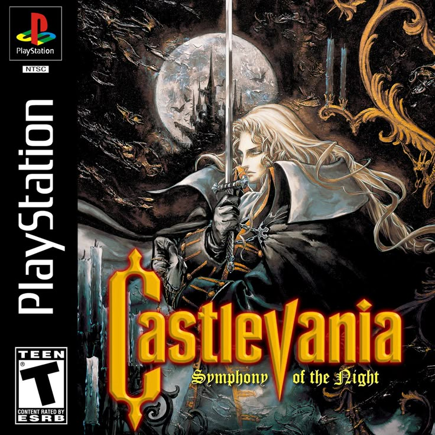
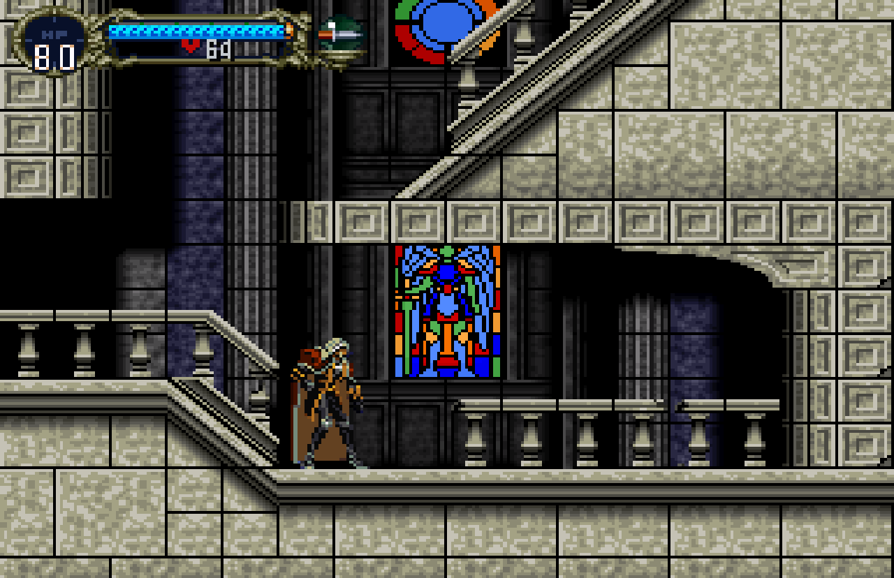
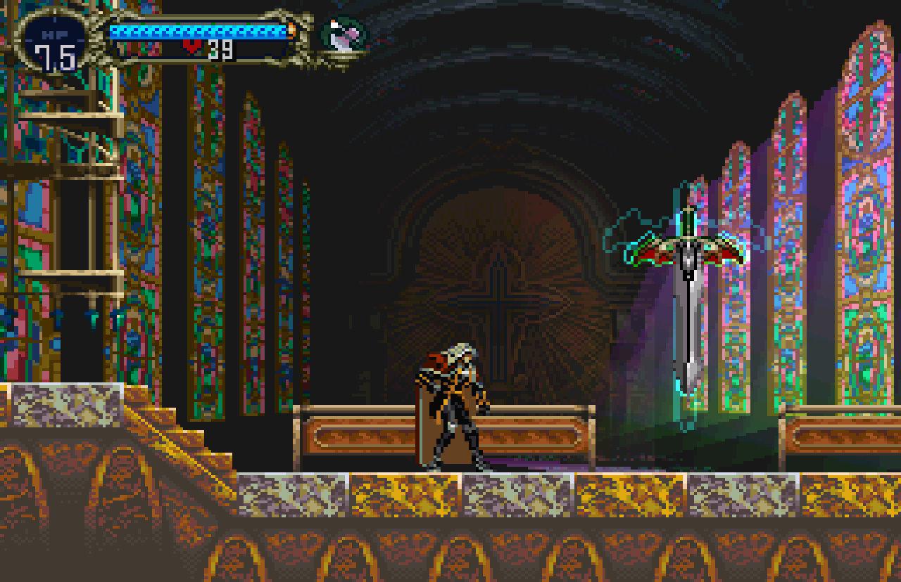
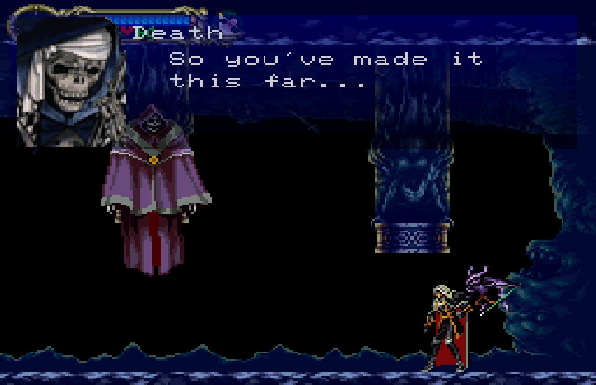
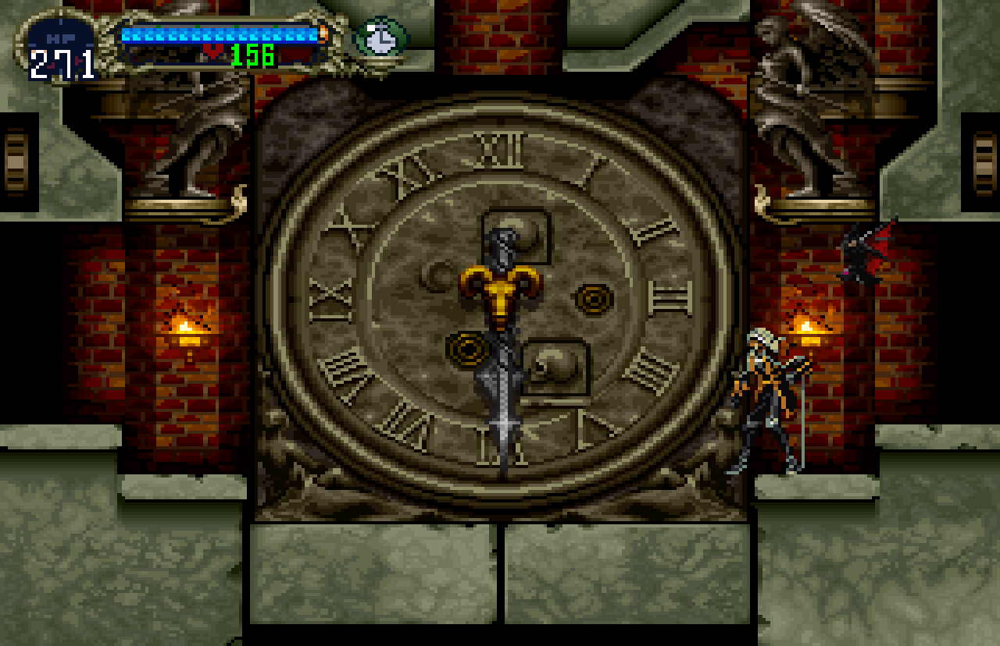
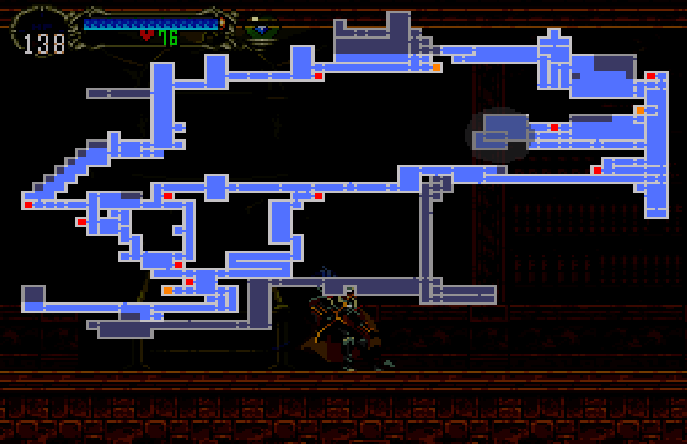
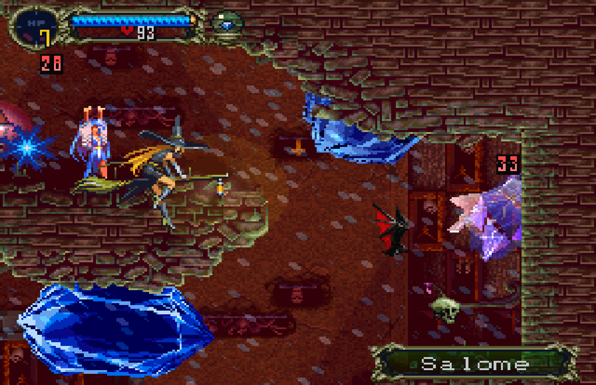

Back in October I was challenged by a couple friends to complete a Castlevania game! I asked for some recommendations, and although some of them wanted me to go for [Dracula X Chronicles](https://jefklakscodex.com/games/psp/castlevania-dracula-x-chronicles/), I decided to go for the one that---along Nintendo's *Super Metroid*---would give birth to a genre that is loved by many today.

During the NES and SNES era, the Castlevania series was pretty much a sequence of challenging levels you would traverse and get good at from start to finish. Though Metroid was already going for a non-linear structure, and Zelda dungeons required items to unlock new paths and exploration, all you had to do in Castlevania was hit enemies and get to the next screen without dying (to be clear I've never played more than a single level of the original game and I apologize for any misrepresentations of the series)

*Castlevania: Symphony of the Night* had a lot to prove. Everyone was jumping on the 3D graphics and polygonal worlds that the Play Station 1 and the Nintendo 64 were known for, but Konami decided to experiment a bit, going for some of the best pixel art of all time, awesome parallax effects and some 3D elements sprinkled here and there.

Even though this game is often compared to Metroid. Apparently they weren't aware of it during development. They borrowed elements from RPGs (like level-up systems to improve your stats) and Zelda (such item-based progression from *A Link to the Past*). In any case, they landed on a very similar path to what *Metroid* did, and built upon it.

At last, after many Metroidvania games under my belt, going from *Metroid Zero Mission* to *Hollow Knight: Silksong*, it was about time I gave a go to one of the originals.

<figure>

<figcaption>I refuse to acknowledge the American box art, enjoy the Japanese box art by Ayami Kojima</figcaption>
</figure>

## Story

Every hundred years, Dracula and his castle awaken from the depths of darkness, bringing despair to the the world once more. Only the Belmont family, sworn protectors of humanity and vampire hunters, can stop it, and soon that will be the case.

The game begins with a playable section, where you get to partake on the last battle of *Rondo of Blood*---the previous game to this one---controlling Richter Belmont . You will get some of the most iconic line delivery in the Play Station, and defeat Dracula after getting powered up.

However, four year later, Richter is missing, and Dracula's Castle suddenly appears before the usual time. Without a Belmont to stop this, Alucard who is Dracula's son, and despises his father's actions, has to step up for the task.

He runs to the Castle at inhuman speeds and gets inside before the bridge lifts up. Fully geared up for battle, the player has a taste of Alucard's power. However, soon enough, Death---the grim reaper---comes to disuade you from your quest, taking away all of your equipment. Here is where the game actually begins.

In general, you can just play this without reading a single line of dialogue and still have a pretty fun time. However---even though it's barely acknowledged in gameplay---there's quite a bit of story, and characters and villains you'll meet are pretty cool.

<figure>

<figcaption>Alucard in one of the many rooms inside this castle</figcaption>
</figure>

## Gameplay

*What is a Metroidvania? just a miserable little pile of secrets!*

In this game, your objective is to explore Dracula's Castle and get to the room at the very top to defeat him! For this, you'll have to traverse multiple rooms armed with nothing but the weapons and equipment you find lying around the multiple rooms of this place, or dropping from defeated enemies.

There are armors, shields and different items you'll get to use as well. Most importantly, Relics. These are toggable quite varied, often tied to different mechanics and features. Some Relics cause items to drop from enemies, one shows the damage dealt to enemies, or increase a particular stat. Some Relics also give you power-ups needed for progression, like the double-jump or the ability to open some doors, there are also "Familiars", these are hovering companions (think Navi from Ocarina of Time) that will aid you in one way or another, attacking enemies, auto-healing you, and such. The most important Relics however, are those that let you *transform!*

Everyone knows that vampires can turn into bats and such, right? Alucard can adopt the Wolf, Mist and Bat forms, each of which allows you to traverse different locations that hide away more secrets and rooms to explore. This is the main way for the game to block progression, as you'll have to endure many challenges and bosses to get these.

<figure>

<figcaption>Definitely one of the prettiest rooms in the game, cool parallax effect</figcaption>
</figure>

Movement itself is pretty fun. It's classic platforming that you gotta get used to, with some extra cool moves like the backdash. This move can be performed infinitely and let's you move back to dodge an attack. It is also faster than walking forward, so lots of players prefer backdashing absolutely everywhere instead of walking, I started doing this pretty late on my playthrough and wish I had realized sooner!

Combat is simple but elegant, you can attack standing or crouching, in the direction you are facing. You cannot make upwards attacks, but you can attack downwards while you jump. You also have access to subweapons. Throwable axes and knives, Holy Water, the Stopwatch, etc. They are attacks that can deal quick chip damage, attack upwards, hit a bigger area, or affect the whole screen. These subweapons have a cost to perform, which is represented by hearts---a very confusing design choice to be honest. You can recover hearts by defeating enemies or hitting pots and candles.

Your weapons are mostly swords, though there are hammers too, you'll really only want to stick with swords. Some are quick and have low range, some are slow but have lots of range and damage. You can pick and choose as you see fit. The game also has shields you can use, but they are really badly implemented, with only a few projectiles that can be blocked and a lot of other attacks that simply damage you anyway. It's worth trying them if a boss gives you trouble though.

<figure>

<figcaption>Death is one of many enemy bosses you'll have to face against!</figcaption>
</figure>

Using items is a bit of a pain. You have to equip items on your hand to use them, removing your ability to use a weapon or shield on that hand until the item is used. This means that you have to constantly fiddle around with menus if you want to use certain items. They are also presented on a list that can't be sorted in any way, which is kind of annoying.

There's also magic! Though you can literally play the whole thing and never use a single spell. Spells are performed by doing button combinations, like special attacks in a fighting games. *Symphony of the Night* doesn't even tell you that you can do them, except by showing you the "Spells" option in the pause menu, greyed out. Some spells seem useful, but I never did one on my playthrough.

Boss fights are quite mixed. Most of the boss designs are pretty cool, and many of the attacks are kinda awesome. Some of them are also kind of unfair. There is however a saving grace, or huge dissapointment depending on how you look at it. Most of the time the AI of these bosses can be broken rather easily. The game asks you to do pattern recognition, and sometimes, that pattern is actually quite simple and easy to trick. Get the boss on a corner, attack it from a safe position, or something like that. It can end up ruining the fight, but honestly, you can make it as hard or easy as you want (by removing equipment or some challenge for yourself) and have the right amount of fun from there. Some weapon combos are just broken and make everything a breeze, so have fun!

It's an old game with some old stuff. You have to manually save on save rooms which can be scarce. There are teleport room, but no menu to choose where to go, you have cycle through locations. If you die, you gotta watch a long death animation and screen, then the game resets and you have to reload your save file and wait for like 20 seconds for everything to load, plus return to where you were from the save room. The map is basic and incomplete, it doesn't have any detail, it doesn't let you mark rooms to return to or see if there are any missing items.  You will miss some of the quality of life features from modern games, but it's nothing to cry about, in my opinion. Save states are always handy via emulation, either way.

<figure>

<figcaption>I wonder if there are any secrets in this ominous clock room</figcaption>
</figure>

## Art & Music

Now then, how about the presentation here? Well, there's not a lot to complain about. In fact, there is nothing to complain about. If this came out today looking exactly the same---maybe with some of the archaic gameplay brought to modern expectations---it would still get plenty of praise.

I don't mind at all when games go for the 8-bit or 16-bit aesthetic. The style of modern titles like *CrossCode*, the chunky pixels in *Celeste*, or the absolute minimalism found in *Hyper Light Drifter*, they all have their merits and are beautiful on their own right, but they are also games made to *look* squareish and perfectly pixelated from the start.

Old titles on the NES and SNES were made for CRT TVs, and they would hide a lot of its pixelation behind the blending of such screens. This is true for Play Station as well, and *Castlevania Symphony of the Night* is the ultimate example of this. There is a pretty popular comparison online of Dracula's eyes, which are a single red pixel that looks a bit dull, but appears much more ominous, shining red, under the blurriness of CRT.

Dracula's castle is full of memorable rooms that are masterfully crafted. Each section has a very different look, from elegant castle rooms full of paintings and statues, to bloodied dungeons and torture chambers, to mechanical-looking contraptions with rotating gears and such. Some rooms are quite simple, some have excellent pixel art, and some others make use of parallax effects and even 3D elements in breath-taking ways, some of the environments actually made original hardware lag because of how much processing they had going on. Simply beautiful stuff.

<figure>

<figcaption>The map is rather simple, but functional enough</figcaption>
</figure>

The music of the game is not far behind, not at all. Castlevania is known for its catchy tunes since the NES days, and SotN continues with the tradition, providing us with a variety of beats and styles. From ominous choruses to upbeat drums and electric guitars. It's all absolutely cool in the best of ways.

Some people may say that the music itself doesn't always fit the vibe of the place where it's playing, but it is undeniable that you end up recognizing where you are not just by the art, but the track in the background.

Voice acting is a whole different beast here. This game has the same clunky delivery of titles like *Resident Evil*. They feel exagerated and the dialogue doesn't flow naturally at all. This doesn't really matter at all though. The dub work is simply iconic at this point and I wouldn't want it any other way.

The PSP version of this game did replace the voice acting though, with a better translation, but the charm of the original is unmatched.

## Overall

<figure>

<figcaption>Look at all those enemies with super cool pixel art sprites</figcaption>
</figure>

This game is pretty much the foundation for most modern Metroidvanias. It has elements that would later be used by *Hollow Knight*, *Prince of Persia: The Lost Crown* and many others, that much is obvious.

I wrote before about how some works end up bested by later efforts. This is only partially true for *Symphony of the Night*. Here are some of the "annoying" things it has:

- The combat is limited since you can't attack up or down
- Some bosses or enemies are annoying to deal with
- Some rooms have way too many enemies that can stun-lock you
- Teleportation rooms are poorly implemented
- It takes a lot of time to load your save after dying
- Using consumable items requires a lot of inputs
- Lots of hidden rooms with little to no way to find them
- Enemy attacks push you off balance, you may fall from platforms a lot
- Spells require time to perform and may never be discovered

Yes, a lot of those annoyances are fairly valid and may be too much if you don't want to deal with any clunky stuff. However, I find most of these are not that big a deal! After all, you can always level up, get stronger, and cheese a lot of the annoying parts. Here is some things I enjoyed to counter the former list:

- Combat is simple and sub-weapons helps to balance things out
- Pretty much everything is easy to beat with a little patience and the right equipment
- You will often find the perfect sub-weapon to use in annoying rooms beforehand
- Save states are a thing to be used at your own discretion
- It's fun to poke around for secrets, there are Relics that help with exploration too
- Very awesome rooms that you will love to discover on your own, nonetheless, fully optional too
- You don't really need spells throughout most of the game
- There are ways to make everything easy, OP equipment or strategies.

This game has a few big secrets that are hidden under very difficult to solve puzzles. The solutions to them are things you may not realize by yourself at all. This is maybe the only real weakness of this game, hiding progression under very unclear secret passages that are not hinted at in the map.

Pretty much all of these annoying secrets are found in the Clock Room area. I will not solve them for you here, but let's just say that such a room can be interacted with in multiple ways, and unlocking the real ending of the game is only possible through it. I won't blame you for looking it up. I think most kids back then would figure these out by accident and tell their friends, or get guides from magazines at the time, so, whatever.

Anyway, other than that silly room with silly secrets, I really enjoyed this game a lot. I filled up almost every room in the castle, going through it multiple times to uncover as many secrets as possible! Another awesome thing that this game has thanks to it's level-up mechanic is that you genuinely feel super powerful by the end, especially when revisiting previous rooms with enemies that don't even deal damage anymore, that's a feeling that isn't present in *Hollow Knight*, but it's kinda nice!

This game does something masterful once you unlock the real ending, and you owe it to yourself to discover it for yourself---though anyone who uses the internet may be spoiled about it. It's pretty much required homework, I'd say, but super fun nonetheless. 

This is day 74 of [#100DaysToOffload](https://100daystooffload.com)
