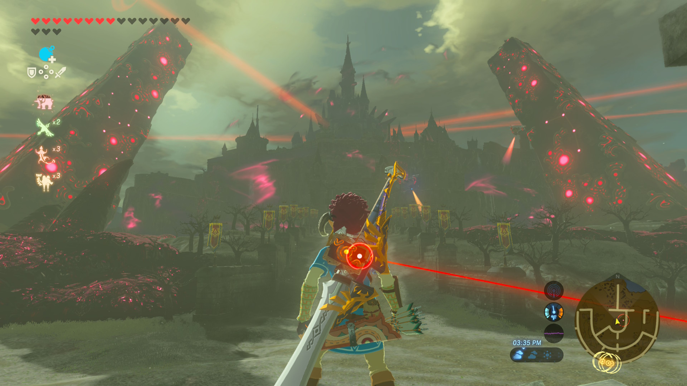
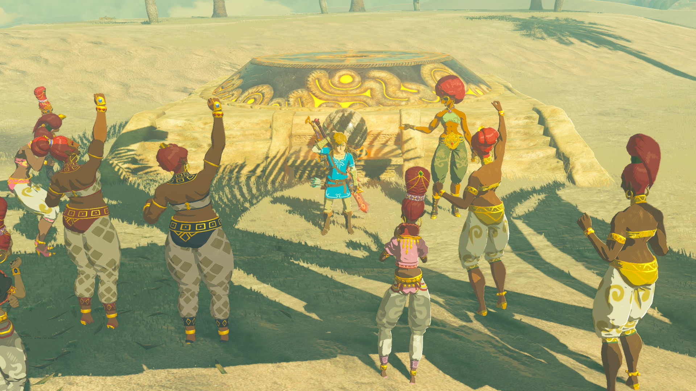
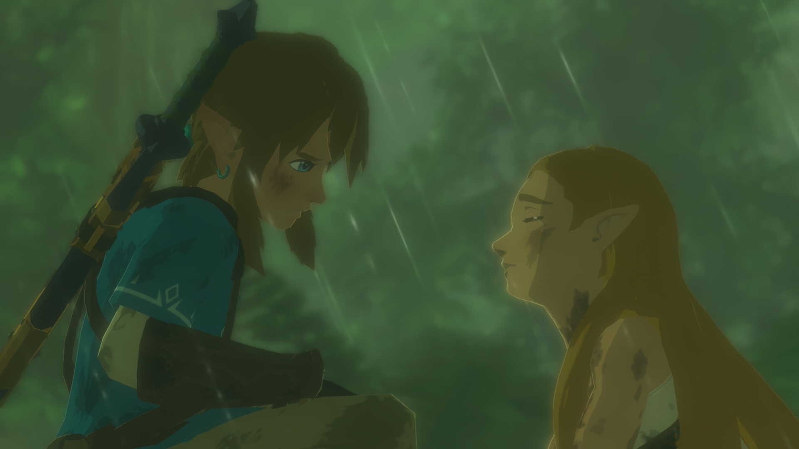
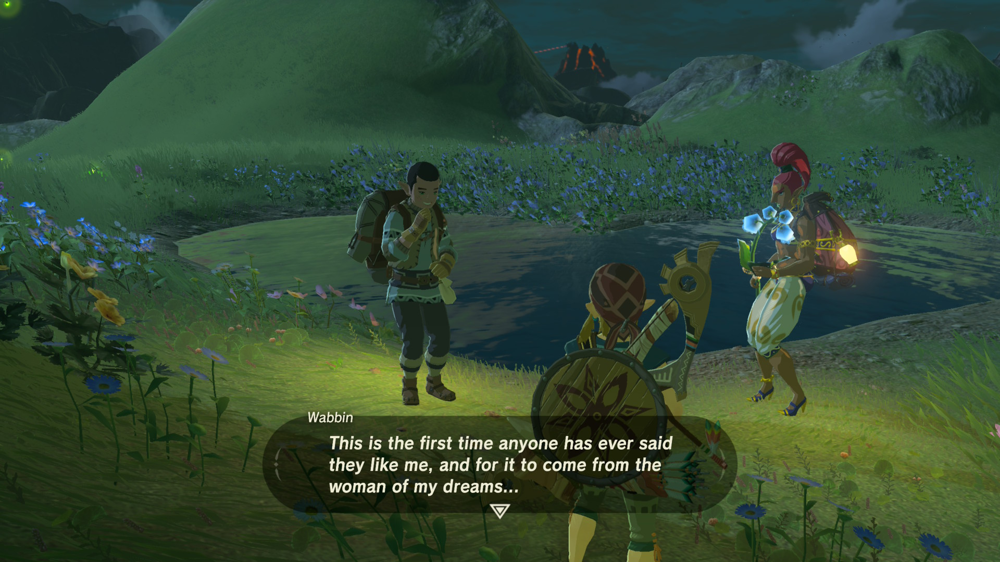
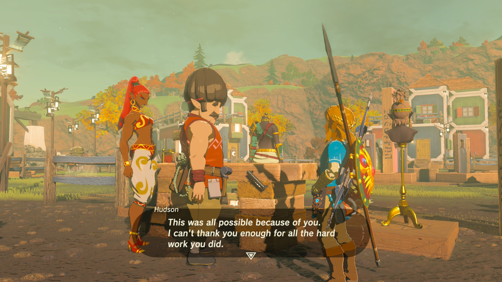
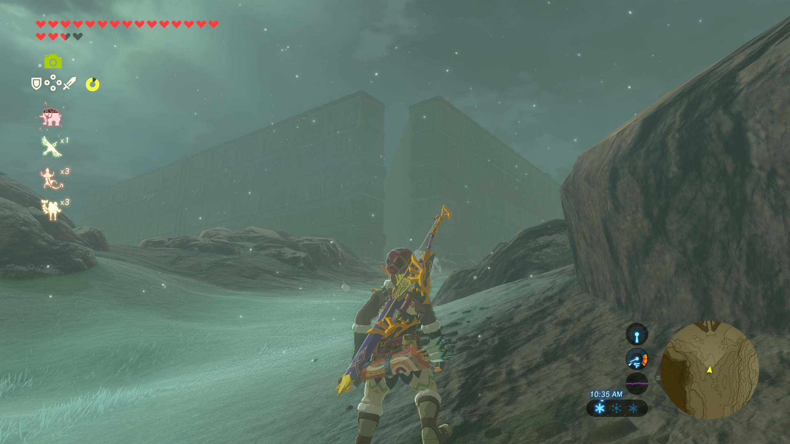
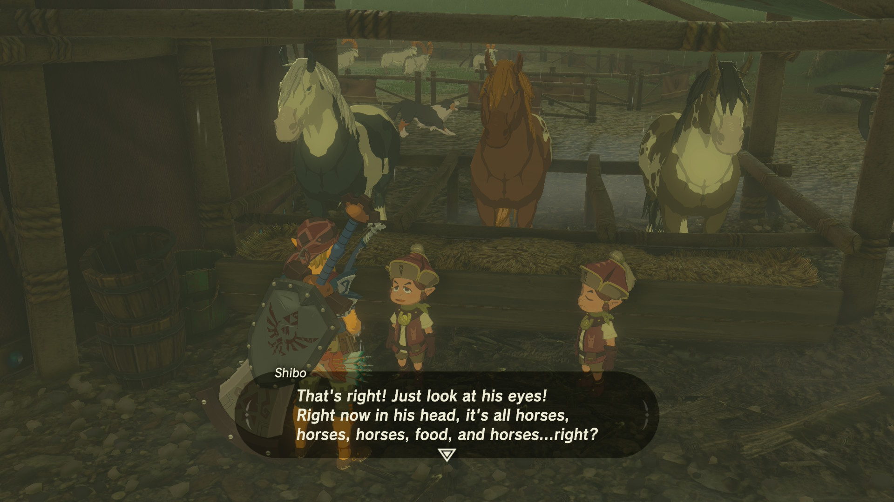

I was at the top of a tower---I could see quite far away. The familiar castle on one side, mountains upon mountains, on the other. I knew I had unfinished business, I wanted to see what was behind the unexplored, hidden by the hills on the horizon.

Standing at edge, I let myself fall, just for a few seconds---then I glided through the air, landing safely by the side of a cliff, my small journey through the mountains continued.

It didn't take too long, before an enemy got in the way, a funny looking creature, nonetheless dangerous---its body was goeey, and burning! It jumped towards me in one move, and I managed to dodge at the last second, not without feeling the heat irradiating from it. I drew my sword, ready for the attack. On a swift motion, I landed a hit.

A second later, my sight was blinded by a white light, a high-pitched sound and a fuzzy head were the consequence of my actions, but at least there was no danger now. The creature had exploded as soon as my sword punctured it, but I was still alive---with a bit of a concussion.

After a quick rest to eat food and treat my injuries, I continued my journey up the mountain. It didn't take long to see a group of those fireballs, probably attracted by the explosion---I knew not if they even had ears to hear it. I couldn't risk close combat again, not with that many of them. I took aim with my bow at one, let go of the arrow---and hit one target. The creature exploded at once! But the others didn't even flinch---I guess fire can't burn fire.

One of them jumped at me, and I managed to dodge just in time. It burned even hotter during their attempt at fighting back, but ended up running out of fuel right after. After noticing this, I took the chance and sliced one with my sword. Having learned out how to deal with them, the rest were easy to defeat.

I kept going up, my legs tired of the journey, but I could see the top already. I saw the view from there, and I knew my little journey was worth it, the green fields of Hyrule. An age old memory invaded me.

***

I wrote the above in July of last year, during a brief moment where I returned to *The Legend of Zelda: Breath of the Wild.* That period---from July 6 to 17, 2025---was rather glorious. I mentioned it in pretty much [all](/blog/2025-w27/) [my](/blog/2025-w28/) [weeknotes](/blog/2025-w29) but the last, when I started *The Hundred Line*---another awesome game which will get the spotlight some other time.

I praised and detailed much of the stuff I had done during that period, defeating the two Divine Beasts I was missing, completing shrines, recovering more memories. I mentioned how close I was to beating this game at last! And I stopped playing it for more than a year, focused on quite a lot of other things.

Some of those new games have been life-changing, some of them have been outside of my comfort zone, all of them have been rather enjoyable.

Then I got a Nintendo Switch 2, and I felt like going back to Hyrule.

<figure>

<figcaption>The castle in front of me, all the Divine Beasts ready to support me</figcaption>
</figure>

While the graphical and performance upgrades have been amazing---the faster loading is just awesome to have---the game really hasn't changed that much. It continues to be an amazing world that I can explore at my own pace.

I continued to complete some of the main quests at hand, most importantly, finding the last of my memories, and letting Impa---who gave me those quests around three years ago by now---know about it. Right now, the only main quest left is going to the castle and facing against Ganon, the final boss of the game. Something you can technically do from the beginning, the game really is that open!

Last year I also purchased the DLC expansion, which includes some extra quests and very interesting improvements. One of the coolest features is the "Hero's Path" view, which allows me to see every single step I've taken throughout the map. I actually didn't even know this was included, as back then I only focused on getting some of the extra gear and the like. Now though, by seeing where I had already been, I could also tell everything I was still missing.

<figure>

<figcaption>I shall not spoil the reason these Gerudo are cheering for me</figcaption>
</figure>

Another cool thing I found is the Zelda Notes app! This is part of the Nintendo Switch App for phones, and it allows you to view stats of the game (such as playtime, enemies defeated and way too many other cool data), and compare it with others. A big feature though is the Voice Memories added all over the map. Recordings from Zelda herself that play whenever you get close to some interesting area. You also get access to a full interactive map where you can see every single location to every shrine, quest, seed and markers, so you can complete 100% of the game. It let's you spoil areas you haven't been to and it doesn't tell you solutions to puzzles though, so it's rather nice to have an extra bit of help. It would be nice for this to built-in to the game, but it is how it is sometimes.

Either way, there were mountains, valleys, pathways, temples, labyrinths, ruins, islands. At every corner of the map, there were still so many environments where I am yet to set foot on. Sometimes, there are rewards at the end of that. Maybe a korok seed, perhaps a chest, or just a strong enemy to challenge myself against, a new shrine to try, or an NPC to help out. Yes, I could use the app for that, but oftentimes I just ignored and went wherever it looked interesting, and it ended up paying off!

Even when there was nothing. I still had a new perspective through which I got to experience this world and let that view simmer for a bit. That's what happened when I wrote what I did a year ago---plus learning how to deal with Fire Chuchus!

## Spoiler talk

In any case, you probably want to know, what exactly have I been up to during these last **twenty five hours** of playtime I've had since my return to the game?

Well, this section will of course **contain spoilers**, even if you only partially completed the game! This is a huge adventure, and I ought to talk about it without reservations. Some of the side quests I've done are rather huge, so it would be nice to go blind at them.

[Skip to the end](#finishing-thoughts)

The first thing I tried was finding the last of my lost memories. One of them was at Hyrule Castle, and the other was found among a rather small bunch of trees, although it was also a very significant scene. One of them showed Zelda being confronted by the King, pressuring her to learn and study her power. The second one was Link and Zelda running away, pursued by Ganon's corruption, when Zelda breaks down, holding on to Link, one of the most powerful moments in the game for me.

After finding these two memories, I returned to Impa, who gave me one last picture with a memory to find. She mentioned that the place was close, so I decided to walked around until I found the place, which brought a memory where Link was barely standing up to defend the princess, who finally understood her inner power, and used it to stop the guardians around them, after seeing this, she had some soldiers take Link to the Shrine of Resurrection, where the game started.

<figure>

<figcaption>Zelda about to break down completely...</figcaption>
</figure>

With this, everything was ready, I knew the truth of what happened before. It was time to go face the Calamity, Ganon, reunite with Zelda, and finally give closure to this!---*or not.*

I wanted to keep going, and so, I did.

I gave myself a challenge, to look for all the remaining Shrine Quests in the game. There are about 42 of them, and I have only completed like 17 of them. I used the Zelda Notes app to get the general location of them all, and, I would figure out the puzzles behind them on my own.

Eventually, I stumbled on an NPC which pointed me towards the mountains. One of them had a huge drawing carved on it, which could be seen from far away. I decided to head there, and I saw some sort of altar surrounded by big lightning symbols. I figured the solution was to get some lightning arrows and fire at the thing.

Here is however, the one quest that took most of my time, and that was the most absolutely unecessary, yet incredibly rewarding!

<figure>

<figcaption>Some guy meeting the woman of his dreams</figcaption>
</figure>

You see, I had no lightning arrows with me, and I didn't remember where to buy them---there are actually plenty of stores that sell them all over Hyrule but I don't know what happened---so I looked it up, and for some reason I stumbled on the name of a shopkeeper I had never seen before. The internet told me that I could unlock that by first buying a House at Hateno Village, and so I did, and an incredible quest got started from there.

*From the Ground Up* is a quest full of surprises. Again, if you haven't played it, **spoilers ahead!**. I recommend you give it a go! though keep in mind it requires some grinding, and I also ended up distracting myself with a lot of extra quests in between.

Anyway. There's this guy who decided to build a whole town by himself (by having me pick up a bunch of wood for him, of course), but the gist of it is that he wants to find different people who would like to live there and help out with stuff. A Goron to help with hard work, a Gerudo who can make clothes, a Rito that wants to start a shop, and a Zora, for something I'll rather keep a surprise. All of these characters have names that end in "-son", and must be looked for all over Hyrule!

<figure>

<figcaption>I'm being thanked for helping out to build a whole town!</figcaption>
</figure>

The best thing about this quest, is that I had to revisit lots of places and talk with people to see if the name fits. I required some help with two of them, but the other two I had seen before, and they actually left an impression on me from much earlier, which honestly surprised me! I think I'd have found the others if only I had spoken with more NPCs in time.

Besideso those characters, there were many others I hadn't interacted with, that gave me other side quests for me to do. Taking a picture of a Lynel, beating a couple Guardians, taking a dive down the lake, finding some little Rito girls who were going to sing together, and many more things.

I played like eleven hours in a single day, all because I wanted to get some lightning arrows, but it ended up paying off so much more, and it was awesome to be part of such a charming little adventure.

<figure>

<figcaption>A rather ominous structure at the distance. It looks kinda alien</figcaption>
</figure>

Another awesome quest was going down to an island at the corner of the map, which I was completely unable to reach before due to a lack of stamina (I guess I could have used a boat to get there much earlier though). In any case, once I got to the island, I was challenged by the Sheikah to survive there on my own, losing all of my equipment and items. I had to recover three orbs with nothing but whatever I found laying in the ground, or from enemies in the area, which I had to best. One of these monsters was a Hinox, whose collar contained the orb I needed. Figuring out how to get around all of that was a blast, and a rather welcome challenge now that I can deal with anything using my OP weaponry.

I have done many more cool quests since then. Helping some fisherman clear up the enemies from a beach, helping some people get together in a lake, deciphering ancient songs that give hints to find Shrines, taking pictures of ruins and landscapes for curious characters, finding statues to hit, casting shadows in particular ways at the right time of the day, defeating enemies that hold the key to some secret, and many, many more.

## Finishing thoughts

I wrote a post about [Ocarina of Time](/blog/back-to-oot/) not too long ago. That game is a return to childhood, dreams and legends, and it's a wonderful experience of its own. Ever since the remake came out, I seriously considered that to be *the game* which would make me buy a Nintendo Switch 2 at last, and yet, it turns out I have no need to.

After all, the 3DS remake is still waiting for my return (along *Fire Emblem Awakening*, whoops), and I also have *Tears of the Kingdom* waiting in the backlog!---though I may need a very big break after I'm done with this.

It is really funny though, how a game from 2017 has entertained me so much, when the game of the moment is of course, *Grand Theft Auto VI*. I was never big on that series---although I dabbled on the PSP entries for quite a while in the past---so I'm okay missing out on it. I did read a blogpost from Brandon sharing [some thoughts about it](https://brandons-journal.com/post/a-few-days-with-grand-theft-auto-vi), and how it's quite the reflection on modern times and a satire that may hit too close to today's world.

I could keep going, I am still playing after all, but this is just a taste, and I don't have enough of it just yet. How am I supposed to even review this one in the future when I've already said so much? We'll see.

Funnily enough, [Brandon also wrote about the Switch 2](https://brandons-journal.com/post/the-simple-joy-of-nintendo) as I am done writing this finishing section, declaring his love for the simplicity of Nintendo games and the like, so that's neat. All I can say is that I'm glad that purchasing this console has made me fall in love with Breath of the Wild all over again.

I am enjoying my time here exploring this desolate land after the calamity, and helping out in small ways to all the goofy characters I stumble upon. Princess Zelda has waited for my return for a hundred years, she will be okay for a while longer---there's more to explore here!

<figure>

<figcaption>Umm... okay?</figcaption>
</figure>

This is day 75 of [#100DaysToOffload](https://100daystooffload.com)
